# Hortobots Planning

Plataforma de Diário de Bordo Digital e Gestão Técnica para as equipes SESI Hortobots FLL, Under Construction FLL e Hortobots OBR do SESI 437 - Hortolândia.

O projeto opera como um monorepo modular em TypeScript. O backend em Node.js com Express e arquitetura hibrida gerencia as requisicoes da API e serve a Single Page Application (SPA) compilada em React + Vite.

## Versões

- **2.1.0 — Painel Administrativo, Menu Lateral e Groq AI:** Menu lateral (Drawer) na Home com as cores das equipes na hierarquia solicitada, Painel Administrativo unificado com autenticação a cada recarga (F5), backup completo em `.zip`, limpeza de banco, alteração de senhas dos perfis, botão de salvar com alto contraste e suporte à Groq API no Estúdio de Banner.
- **2.0.0 — Notificações e Visualização Universal:** Alertas por e-mail via API do Gmail, Lei Geral de Visualização Irrestrita de registros para todos os perfis, temporada FLL BIOGLOW 2026/2027 e OBR Resgate 2026 nos diários, e exportação de Banner Científico compatível com Canva.com.
- **1.1.0 — Colaboração e desempenho:** pontuação oficial BIOGLOW, aproveitamento por teste, banners editáveis no Canva, avisos de eventos importantes e feedbacks da Gestão.
- **[1.0.0 — Lançamento estável](CHANGELOG.md#100--2026-10-10):** reúne autenticação e permissões, três cadernos de equipe, registros, testes, gráficos, calendário, pesquisa geral, mídias, PDFs, persistência local/nuvem e a primeira auditoria responsiva completa.
- O histórico completo e detalhado com todos os prompts na íntegra está disponível em [CHANGELOG.md](CHANGELOG.md).

---

## 1. Visao Geral e Arquitetura

O sistema adota o padrao de persistencia hibrida com desacoplamento de infraestrutura:

- **Modo Nuvem (Render + Supabase):**
  - Hospedagem no Render via Blueprint (`render.yaml`).
  - Persistencia relacional no PostgreSQL do Supabase (`records`, `events`, `tests`).
  - Armazenamento de arquivos e midias em Supabase Storage.
  - Ativado automaticamente com `STORAGE_DRIVER=supabase`.

- **Modo Local (Simulacao de Desenvolvimento):**
  - Persistencia orientada a arquivos JSON e midias locais na pasta `Logs/` (`registros`, `testes`, `eventos`).
  - Execucao agil sem necessidade de conexao externa ativa.
  - Ativado com `STORAGE_DRIVER=local`.

---

## 2. Estrutura do Monorepo

```text
hortobots-planning/
├── apps/
│   ├── api/              # Servidor Node.js + Express (API REST e entrega estatica)
│   └── web/              # Interface SPA React + Vite + CSS Design System
├── packages/
│   └── shared/           # Tipos TypeScript, constantes e schemas Zod compartilhados
├── supabase/
│   └── migrations/       # Scripts SQL DDL de inicializacao do banco de dados
├── scripts/              # Utilitarios de auditoria, no-emoji e processamento de imagens
├── Logs/                 # Armazenamento local de desenvolvimento
├── render.yaml           # Configuracao de deploy declarativo no Render
└── package.json          # Workspaces e orquestracao de scripts npm
```

---

## 3. Funcionalidades Principais

- **Diário de Bordo Técnico:**
  - Registro cronologico de atividades, hipoteses, problemas e solucoes.
  - Segmentação por caderno e identidade visual: SESI Hortobots FLL (verde), Under Construction FLL (roxo e rosa) e Hortobots OBR (vermelho, dourado e preto).
  - Associacao de metadados, tags tecnicas e galeria de midias (fotos e videos).

- **Calendario Oficial de Atividades:**
  - Calculo matematico real de dias e semanas (sem distorcoes de datas).
  - Destaque em tempo real do dia atual no fuso horario de Sao Paulo (`America/Sao_Paulo`).
  - Navegacao dedicada no trimestre critico (Outubro, Novembro e Dezembro).
  - Integracao unificada exibindo registros de diario, testes de robo e eventos na data selecionada.
  - Controle de prioridade de eventos (Comum / Urgente).

- **Fluxo de Autorizacao de Eventos:**
  - Mentores podem planejar e cadastrar novos eventos na agenda.
  - Eventos urgentes entram no estado `PENDENTE` e exigem aprovacao expressa da conta `Gestao` (`PATCH /api/eventos/:id/confirmar`).

- **Matriz de Permissões:**

  | Perfil | Registros e testes | Eventos | Aprovação |
  | --- | --- | --- | --- |
  | Gestão | Somente visualização | Criar | Confirmar pendentes |
  | Mentor | Somente visualização | Criar, editar e excluir | Não |
  | Aluno FLL | Criar, editar e excluir registros e testes dos dois cadernos FLL | Somente visualização | Não |
  | Aluno OBR | Criar, editar e excluir registros e testes do caderno OBR | Somente visualização | Não |
  | Visitante | Consulta pelo calendário e pesquisa geral | Somente visualização | Não |

- **Simulacoes e Testes de Robos:**
  - Registro de ciclos de testes com quantidade variavel de tentativas (3 a 15).
  - Metricas de tempo, pontuacao observada e taxa de falhas.
  - Visualizacao grafica de desempenho em linha, barras ou circular.
  - Pontuação FLL vinculada ao teto oficial de 530 pontos da temporada BIOGLOW 2026/2027, com aproveitamento percentual, faixa de desempenho, pontos restantes e tabela detalhada de missões/discos de precisão.
  - Pontuação máxima OBR configurável por teste, pois o teto depende da composição da arena, do nível e da fase.

- **Banner científico A×B:**
  - Um banner persistente por equipe, criado pela pergunta-problema, registros do caderno, testes do robô e anexos DOCX, XLSX, PDF, TXT, MD ou CSV.
  - Síntese curta por `gpt-5-nano` quando a chave está configurada e modo local determinístico quando não está.
  - Exportação PPTX em dimensões personalizadas: textos, formas e blocos permanecem independentes para importação e edição elemento por elemento no Canva.
  - Após a criação, a interface exibe somente **Atualizar Banner**, **Baixar para Canva** e **Excluir Banner**.

- **Colaboração da Gestão:**
  - Feedbacks em formato de comentários para registros, testes e eventos, publicados exclusivamente pela Gestão com as tags Direção, Coordenação ou Técnico.
  - Eventos importantes disparam um e-mail responsivo pela API Gmail para os três destinatários cadastrados exclusivamente pelo Mentor.
  - O botão do e-mail abre o login já selecionado como Gestão e, após autenticar, conduz ao calendário com o evento aberto para confirmação ou recusa opcional.

- **Exportacao para PDF:**
  - Registros e testes abertos podem ser baixados por qualquer perfil, inclusive visitante.
  - O arquivo usa folhas A4 em retrato, paginação automática, cabeçalho com as marcas da equipe e da competição e identidade visual específica de cada caderno.
  - Textos, tags, métricas, tentativas, gráficos, imagens e capas de vídeos são organizados em quantas páginas forem necessárias.
  - A geração acontece localmente no navegador com `@react-pdf/renderer`, sem serviço pago, cota externa ou envio do conteúdo a uma API de terceiros.

- **Portal independente Hortobots BIOGLOW:**
  - Acesso público pela tela de login e acesso direto pela Home ou pelo caderno SESI Hortobots.
  - O site da equipe é compilado a partir de seu repositório próprio e executado pelo domínio do Planner em um `iframe` isolado, com uma única área de rolagem e barra própria de retorno.
  - O bundle aprovado fica em `apps/web/public/bioglow`; portanto, a produção não depende de GitHub Pages nem de um segundo servidor.
  - O comando `npm run sync:bioglow` recompila o repositório irmão e atualiza somente esse bundle, preservando a separação de autoria e histórico.
  - O Planner fornece somente o endpoint público `/api/public/teams/sesi-hortobots-fll`, que retorna registros e testes do SESI Hortobots FLL.
  - As notícias usam feeds RSS públicos por um relay restrito no próprio Node (`/api/public/biology-feed/:feed`) e tradução pública MyMemory; nenhuma chave de IA é necessária ou exposta.
  - Carregamento e navegação usam um contrato mínimo por `postMessage`, sem compartilhar CSS, dependências ou ciclo de publicação.
  - A arquitetura possui um registro de portais extensível, mas somente o portal realmente existente do SESI Hortobots está cadastrado e exibido.

### Exemplos da exportação PDF

Cada documento abaixo foi gerado pelo mesmo componente usado pelo botão **Baixar PDF** da plataforma. Clique na prévia para abrir o arquivo A4 completo.

| SESI Hortobots FLL | Under Construction FLL | Hortobots OBR |
| --- | --- | --- |
| [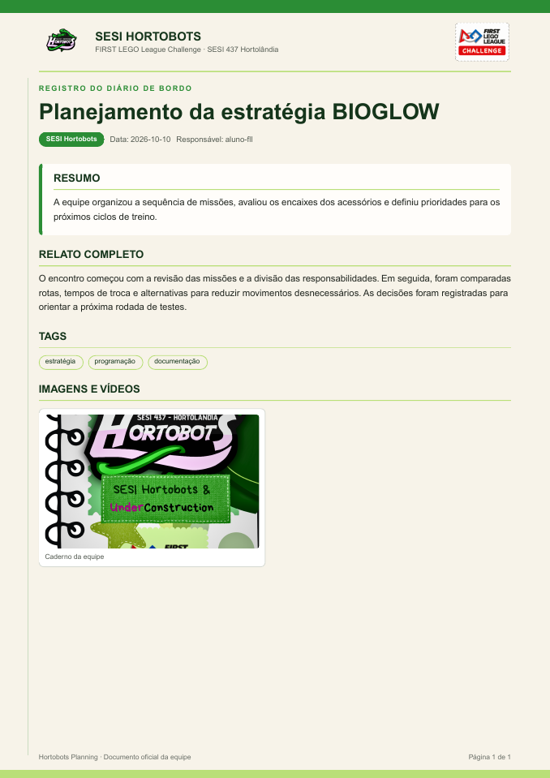](output/pdf/exemplo-registro-sesi-hortobots.pdf) | [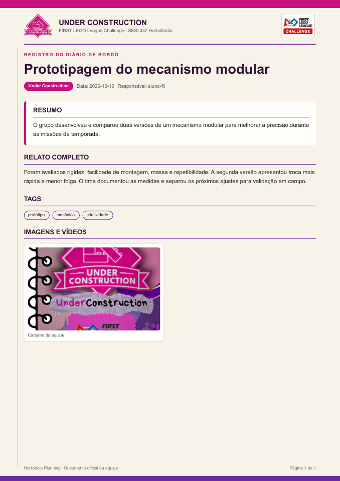](output/pdf/exemplo-registro-under-construction.pdf) | [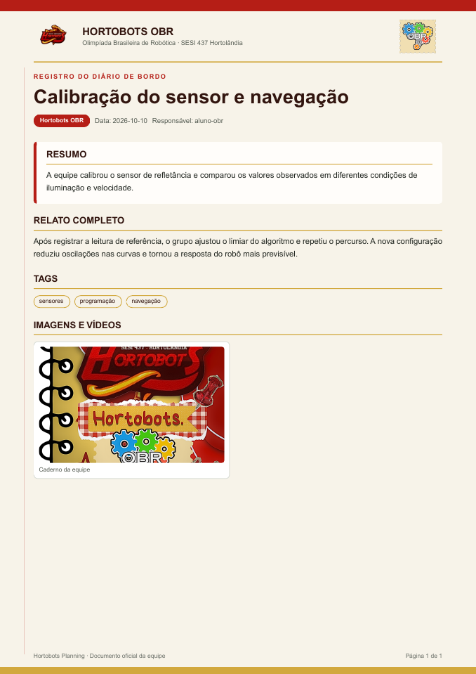](output/pdf/exemplo-registro-hortobots-obr.pdf) |
| Identidade verde e branca, com marca FIRST LEGO League Challenge. | Identidade rosa e roxa, com marca FIRST LEGO League Challenge. | Identidade vermelha e dourada, com marca da Olimpíada Brasileira de Robótica. |

- **Design System e Fluidez:**
  - Transicoes suaves entre rotas e paineis (`.page-transition`).
  - Estetica baseada em cadernos tecnicos de engenharia.
  - Conformidade estrita com a regra universal de proibicao de emojis no codigo e interface.

---

## 4. Telas e Fluxo de Uso

As telas abaixo estão na ordem em que aparecem no fluxo principal. Quando uma função é paralela entre equipes, a documentação segue a hierarquia **SESI Hortobots FLL > Under Construction FLL > Hortobots OBR**.

### 4.1 Carregamento da aplicação

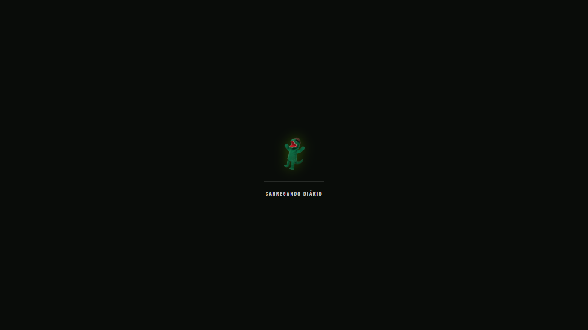

A cortina de carregamento impede que fontes, fundos e sprites apareçam progressivamente. Ela permanece visível por um intervalo mínimo e só libera a interface após a decodificação dos recursos críticos, o carregamento das fontes e a estabilização dos elementos visuais no DOM. Um limite de segurança evita bloqueio permanente em caso de falha de rede ou arquivo.

### 4.2 Autenticação por perfil

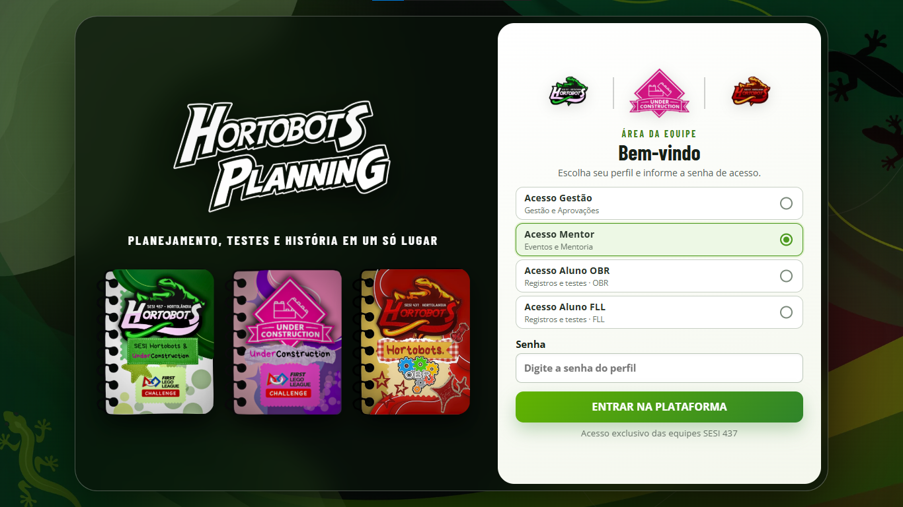

O usuário escolhe diretamente um dos quatro perfis fixos e informa a senha correspondente. Gestão acompanha e aprova; Mentor administra eventos e a mentoria; Aluno OBR cria, edita e exclui registros e testes do caderno OBR; Aluno FLL faz o mesmo nos cadernos SESI Hortobots e Under Construction. Essas permissões pertencem ao perfil e ao caderno, independentemente de quem criou o item. A opção **Somente visualizar** abre o calendário e a pesquisa geral sem autenticação, enquanto **Hortobots BIOGLOW** abre o portal público da equipe. Visitantes e contas autenticadas podem abrir o conteúdo completo de registros, testes e eventos. A sessão controla tanto os elementos exibidos quanto a autorização efetiva de cada requisição no servidor.

### 4.3 Escolha do diário e Menu Lateral da Home

A tela Home apresenta os três cadernos de forma limpa, espaçada e respirável, sem botões soltos na base.
Toda a navegação da plataforma foi organizada em um **Menu Lateral (Drawer)** acionado pelo botão `MENU` no topo:

- **Hierarquia Estrita do Menu:**
  1. **CALENDÁRIO:** Agenda completa de eventos, com navegação contínua e destaques de eventos comuns e urgentes.
  2. **PESQUISAR REGISTROS:** Motor de busca e filtros combinados de texto, data e tags em todos os cadernos.
  3. **VER REGISTROS:** Agrupador expansível que exibe 3 botões estilizados nas cores das equipes:
     - **SESI Hortobots FLL** (Verde `#22c55e`)
     - **Under Construction FLL** (Magenta `#d946ef`)
     - **Hortobots OBR** (Vermelho `#ef4444`)
  4. **BANNER A × B:** Agrupador expansível com atalhos para os banners de cada time.
  5. **PORTAL BIOGLOW:** Acesso ao portal oficial da equipe.
  6. **PAINEL ADMINISTRATIVO:** Botão exclusivo para a conta **Mentor**, destacado com ícone `<Shield />`.

### 4.4 Painel Administrativo do Sistema

Acesso exclusivo para manutenção e administração de dados (`/admin` e `/mentor/configuracoes`):

- **Autenticação em Memória (Exigida a cada F5):** A sessão administrativa não utiliza armazenamento persistente; qualquer recarga de página exige nova validação de senha (`Horto#Mentor26`).
- **Status do Banco de Dados:** Medição em tempo real do volume de armazenamento ocupado (`storageMb`), quantidade de eventos, registros de diários, testes de simulação e total de itens.
- **Backup Completo (.zip):** Download instantâneo de um arquivo compactado `.zip` contendo os dados do SQLite, arquivos exportados e índice de mídias.
- **Esvaziamento Seguro do Banco:** Limpeza integral com confirmação por digitação (`CONFIRMAR`).
- **Destinatários de Alertas por E-mail:** Gerenciamento dos endereços da Gestão/Direção, Coordenação e Técnico, com botão de salvamento de alto contraste visual verde sólido `#16794b` com texto branco.
- **Alteração de Senhas:** Redefinição de senha para qualquer perfil (`gestao`, `mentor`, `aluno_fll`, `aluno_obr`) e da própria senha mestra administrativa.
- **Botão Voltar ao Início:** Retorno rápido à Home em qualquer estado do painel.

### 4.5 Portal independente Hortobots BIOGLOW

O botão **Hortobots BIOGLOW** abre o site oficial da equipe SESI Hortobots FLL dentro de um host isolado e responsivo, renderizado pelo próprio Planner. Uma barra permanece disponível para voltar à plataforma. A integração aguarda o sinal de carregamento do site e fornece apenas os endereços necessários para o retorno e para o acervo público da equipe.

O código-fonte continua pertencendo ao repositório oficial [Hortobots/BIOGLOW-site](https://github.com/Hortobots/BIOGLOW-site) e não importa componentes do Planner. Uma nova versão pode ser incorporada executando `npm run sync:bioglow` após atualizar o repositório irmão. O arquivo `source.json` incluído no bundle registra exatamente qual commit foi integrado.

### 4.5 SESI Hortobots FLL

#### Navegação do caderno

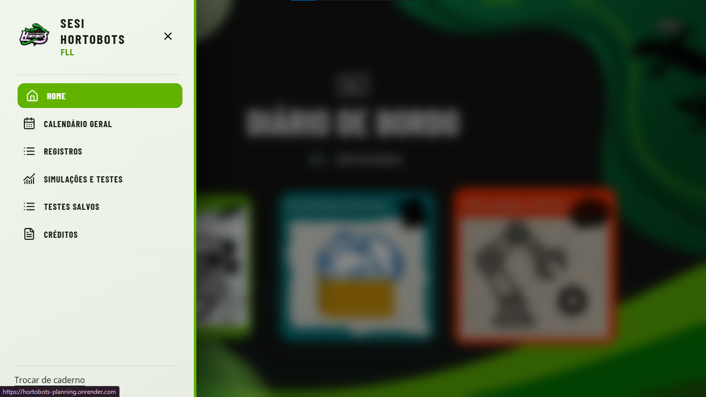

O menu lateral reúne home do caderno, calendário geral, registros, simulações e testes salvos. A abertura usa foco visual e desfoque do conteúdo ao fundo; a identidade verde e branca acompanha toda a sessão do SESI Hortobots FLL.

#### Página inicial do diário

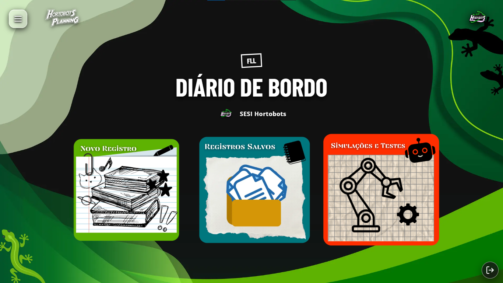

O painel oferece três ações centrais: criar um registro, consultar registros salvos e abrir simulações e testes. A marca da equipe e o fundo confirmam o contexto antes de qualquer lançamento.

#### Simulações FLL e missões da temporada

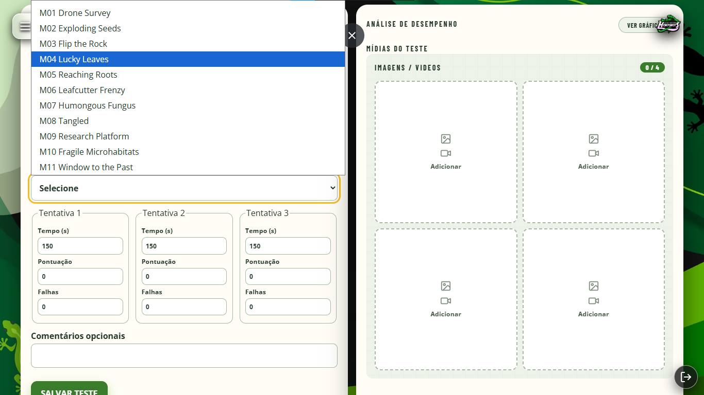

O formulário FLL registra de 3 a 15 tentativas, tempo, pontuação, falhas e missões oficiais realizadas. O painel complementar recebe até quatro imagens ou vídeos e gera análise gráfica em linha, barras ou formato circular antes do salvamento. Cada teste pode ser associado a registros do diário.

### 4.6 Under Construction FLL

#### Navegação do caderno

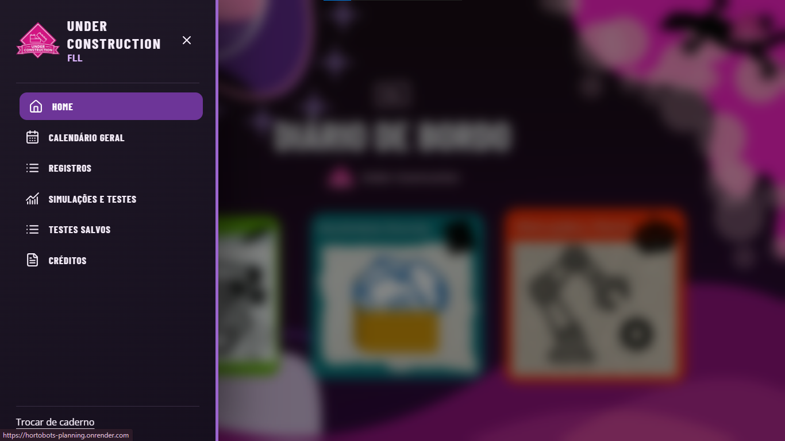

O terceiro caderno mantém a estrutura funcional da modalidade FLL, mas separa registros, testes e identidade da equipe Under Construction. Menu, realces e fundo usam roxo, rosa, preto e branco para impedir confusão com o SESI Hortobots.

#### Página inicial do diário

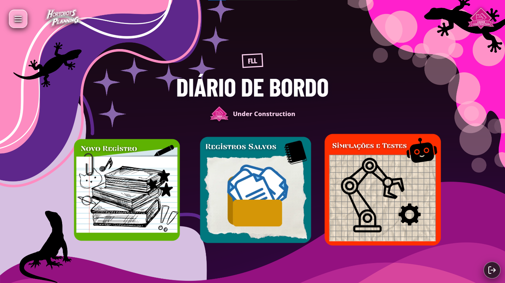

O hub da equipe disponibiliza novo registro, registros salvos e simulações e testes. As rotas usam a tag de equipe Under Construction, garantindo filtragem correta no calendário, no acervo e nas associações entre testes e relatórios.

#### Registros salvos da equipe

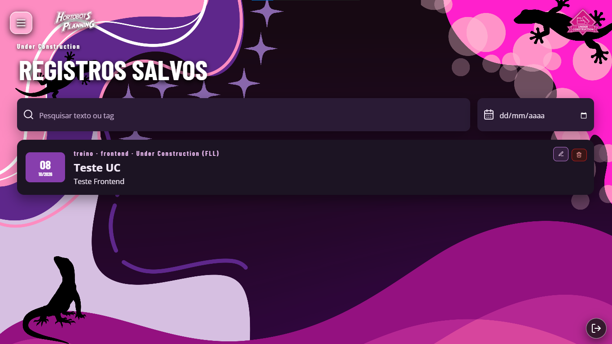

A listagem oferece pesquisa por texto ou tag e filtro por data. Cada cartão resume data, título, conteúdo e identidade da equipe; usuários autorizados recebem também ações de edição e exclusão.

### 4.7 Hortobots OBR

#### Navegação do caderno

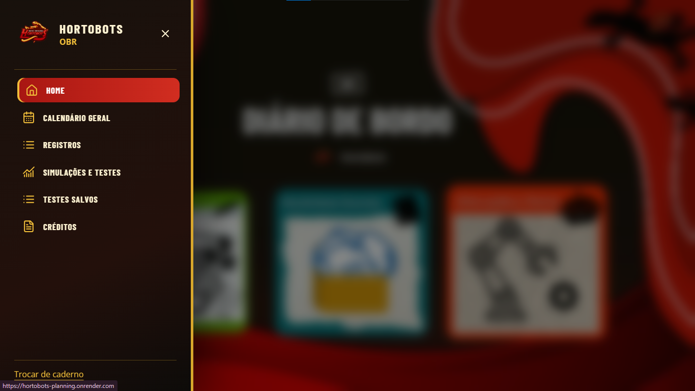

O menu OBR apresenta as mesmas áreas essenciais com identidade vermelha, dourada e preta. A separação de rota e modalidade impede que lançamentos da OBR sejam misturados aos dois cadernos FLL.

#### Página inicial do diário

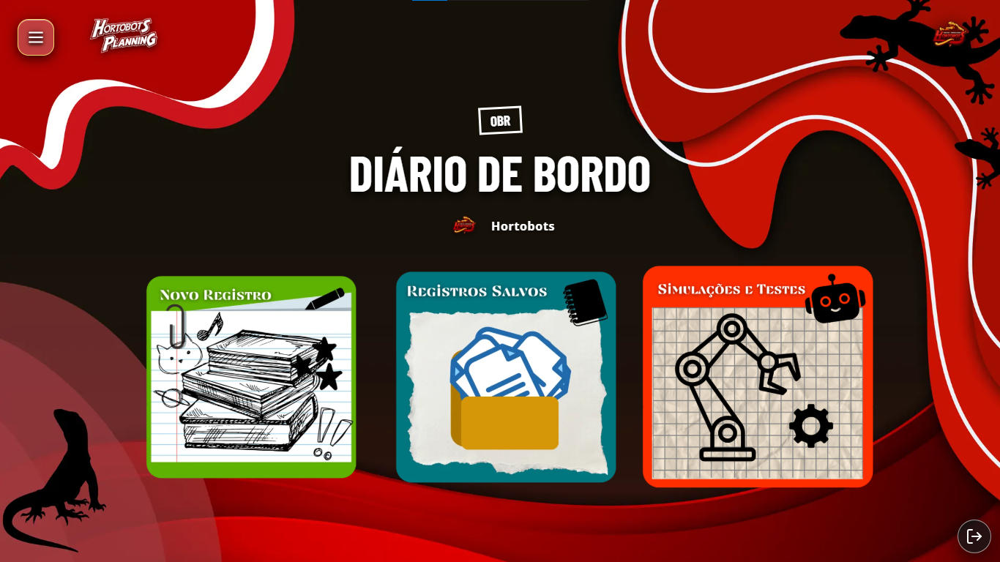

O painel centraliza novo registro, consulta do histórico e testes do robô. Logo, fundo e cores deixam evidente que todas as ações seguintes serão persistidas na modalidade OBR.

#### Simulações e testes OBR

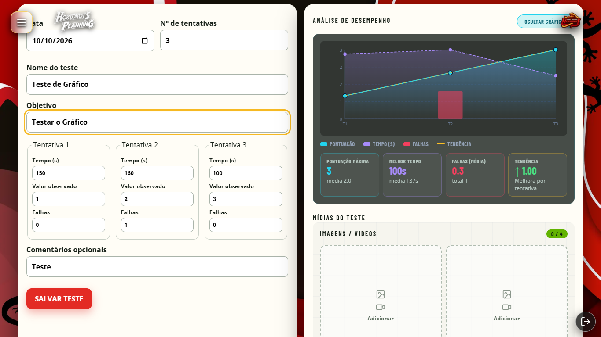

O teste OBR registra data, nome, objetivo e de 3 a 15 tentativas com tempo, valor observado e falhas. A análise mostra evolução, melhor tempo, média, falhas e tendência, além de aceitar fotos e vídeos. O gráfico pode ser ocultado para ampliar a área de preenchimento ou aberto em foco para inspeção.

### 4.8 Recursos compartilhados

#### Editor de registro

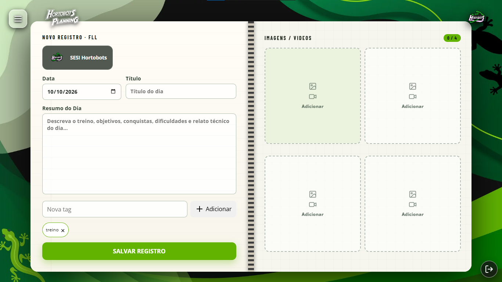

O caderno aberto divide o trabalho em duas páginas do mesmo tamanho. A primeira recebe equipe, data editável, título, resumo e tags personalizadas; a segunda organiza quatro áreas quadradas para imagens e vídeos. O conteúdo textual cresce apenas no eixo vertical e as mídias podem ser abertas em foco ou removidas com confirmação.

#### Calendário geral

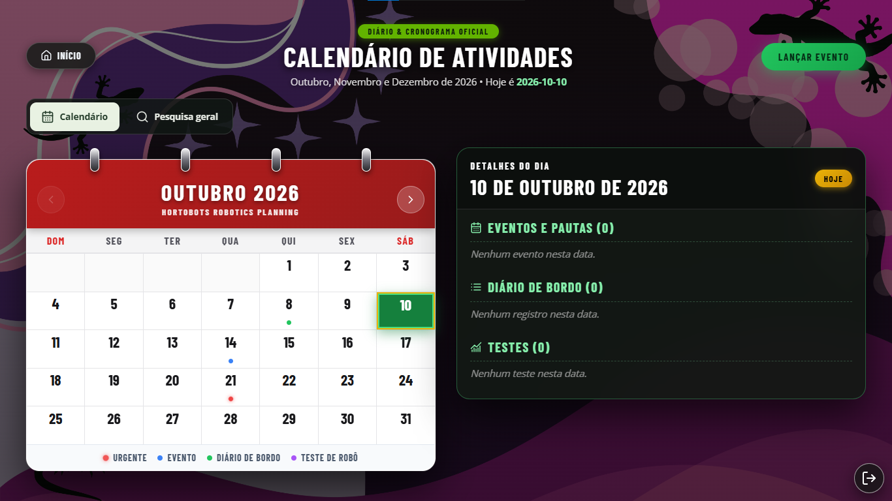

O calendário unifica eventos, registros e testes de todas as equipes. Marcadores por cor indicam o tipo de atividade e o painel do dia apresenta os itens selecionados. Calendário e pesquisa geral também podem ser consultados em modo visitante; criação, edição, exclusão e aprovação permanecem condicionadas às permissões da conta.

#### Lançamento de evento

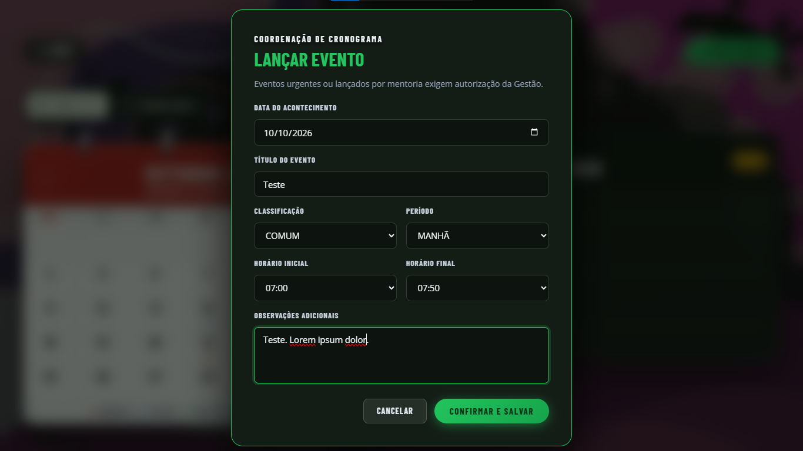

O modal de cronograma registra data, título, classificação comum ou urgente, período, horários por aula e observações. Eventos que exigem autorização ficam pendentes até a confirmação da Gestão, mantendo o planejamento separado dos registros técnicos.

#### Pesquisa geral do acervo

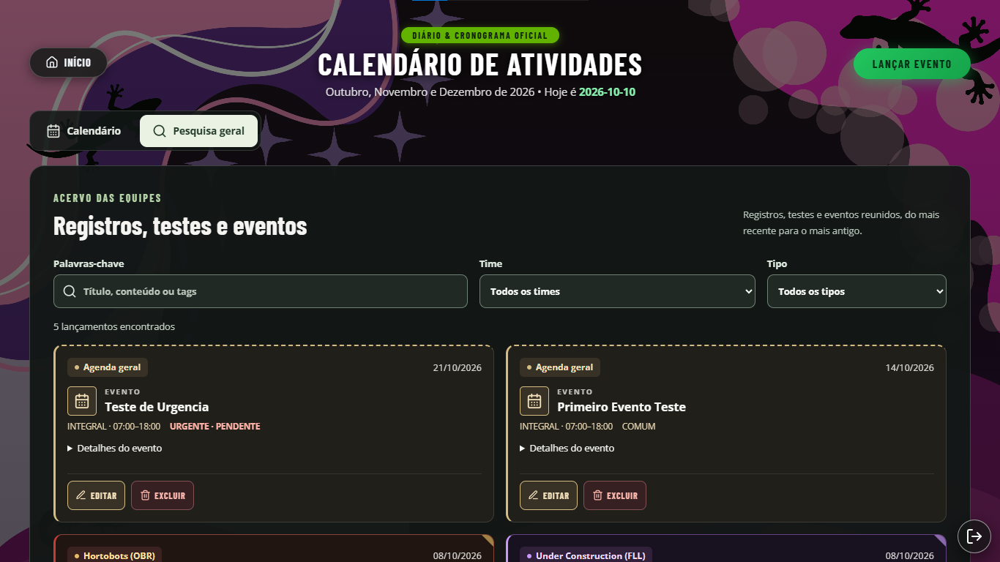

A guia reúne todo o acervo em ordem cronológica decrescente. A busca encontra título, conteúdo, tags, datas e nomes de mídia; os filtros por equipe e por tipo refinam os resultados. Os cartões preservam as cores de cada time e apresentam as ações permitidas ao perfil autenticado.

---

## 5. Guia de Instalacao e Execucao Local

### Pre-requisitos
- Node.js versao 20 ou superior.
- npm versao 10 ou superior.

### Instalacao de Dependencias
```bash
npm install
```

### Processamento de Assets Graficos (opcional / inicial)
```bash
npm run assets
```

### Execucao em Modo de Desenvolvimento Local (Logs)
Para executar a API em modo local (`Logs/`) em conjunto com o servidor Vite:
```bash
npm run dev:local
```
- Frontend acessivel em: `http://localhost:5173`
- Servidor de API acessivel em: `http://localhost:3000`

---

## 6. Comandos de Build e Validacao

### Compilacao Completa do Projeto
Gera os artefatos compilados em todos os workspaces (`shared`, `api` e `web`):
```bash
npm run build
```

### Compilacao por Workspace
```bash
# Pacote compartilhado
npm run build -w @hortobots/shared

# Backend Express
npm run build -w @hortobots/api

# Frontend React SPA
npm run build -w @hortobots/web
```

### Verificação da exportação PDF

Gera três amostras reais, uma para cada equipe, para validar paginação, cabeçalhos, identidades visuais e mídias:

```bash
npm run verify:pdf
```

Os arquivos são gravados em `output/pdf/` e servem como artefatos de inspeção visual e regressão.

### Testes de Conformidade e Tipagem
```bash
# Validacao de regra sem emojis
npm run check:emoji

# Verificacao estrita de tipos TypeScript
npm run typecheck

# Analise estatica de codigo
npm run lint
```

---

## 7. Deploy e Producao

### Execucao da Versao de Producao Localmente
```bash
npm run build
npm run start:local
```
O servidor Express servira a aplicacao completa na porta 3000 (`http://localhost:3000`).

### Deploy no Render com Supabase
O arquivo `render.yaml` esta configurado para execucao no Render:
- **Build Command:** `npm ci && npm run check:emoji && npm run build`
- **Start Command:** `npm run start:render`
- **Health Check Path:** `/api/health`

### Variaveis de Ambiente Necessarias no Servidor
Configure as seguintes chaves no painel do Render ou arquivo `.env`:
```ini
NODE_VERSION=20
STORAGE_DRIVER=supabase
SUPABASE_URL=https://<seu-projeto>.supabase.co
SUPABASE_SERVICE_ROLE_KEY=<sua-service-role-key>
SUPABASE_BUCKET=hortobots-planning
PORT=3000
PUBLIC_APP_URL=https://seu-dominio.example
OPENAI_API_KEY=<opcional; ativa a síntese por IA>
OPENAI_BANNER_MODEL=gpt-5-nano
GOOGLE_CLIENT_ID=<cliente OAuth do Google>
GOOGLE_CLIENT_SECRET=<segredo OAuth do Google>
GOOGLE_REFRESH_TOKEN=<refresh token com escopo gmail.send>
GMAIL_SENDER=me
GMAIL_FROM_EMAIL=<conta Gmail autorizada>
```

Antes do primeiro deploy da versão 1.1.0 no Supabase, aplique `supabase/migrations/0003_collaboration_banner_notifications.sql`. O passo a passo das integrações está em [docs/INTEGRACOES.md](docs/INTEGRACOES.md).

---

## 8. Padroes de Codigo e Boas Praticas

1. **TypeScript Estrito:**
   Configuracao com `strict: true` e `noUncheckedIndexedAccess`. Evita-se uso indiscriminado de `any`.
2. **Seguranca de Chaves:**
   Chaves privilegiadas (`service_role`) permanecem restritas ao backend. O cliente consome apenas a chave publica `anon`/`publishable`.
3. **Imutabilidade e Tratamento de Datas:**
   Datas de acontecimento sao manipuladas no formato textual `YYYY-MM-DD` preservando a data nominal sem interferencia indevida de fuso horario na persistencia.
4. **Resiliencia da API:**
   Uso de rate-limit contra abusos, sanitizacao de nomes de arquivos para evitar path traversal e protecao de rotas via tokens criptografados.
5. **Carregamento Visual Deterministico:**
   A cortina inicial aguarda `document.fonts.ready`, pré-carregamento e `HTMLImageElement.decode()` dos sprites críticos, duas passagens estáveis do DOM e um tempo mínimo de apresentação. Mudanças de rota usam o mesmo mecanismo com duração reduzida.
6. **Movimento e Compatibilidade:**
   Transições declaram propriedades específicas e priorizam `transform` e `opacity`. Quando o sistema solicita movimento reduzido, deslocamentos decorativos são removidos, mas feedbacks curtos de cor, sombra, foco e opacidade continuam suaves e perceptíveis.
